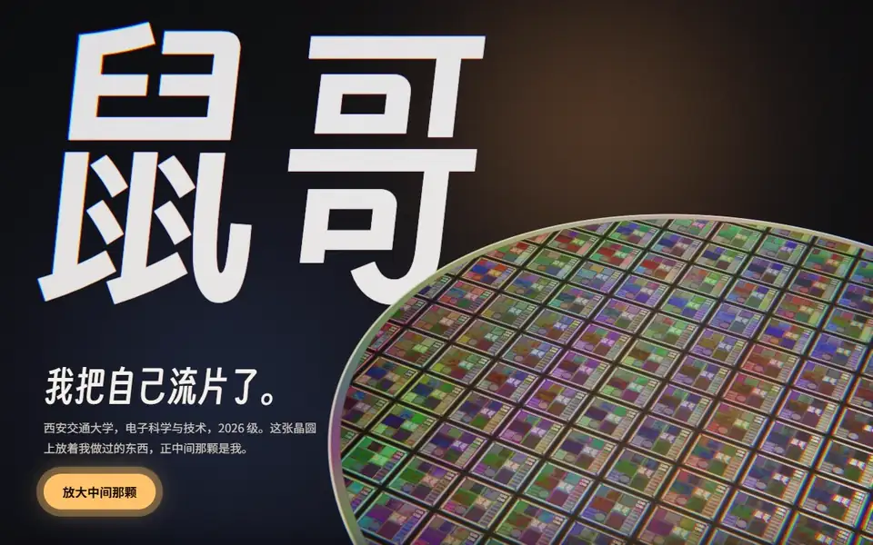
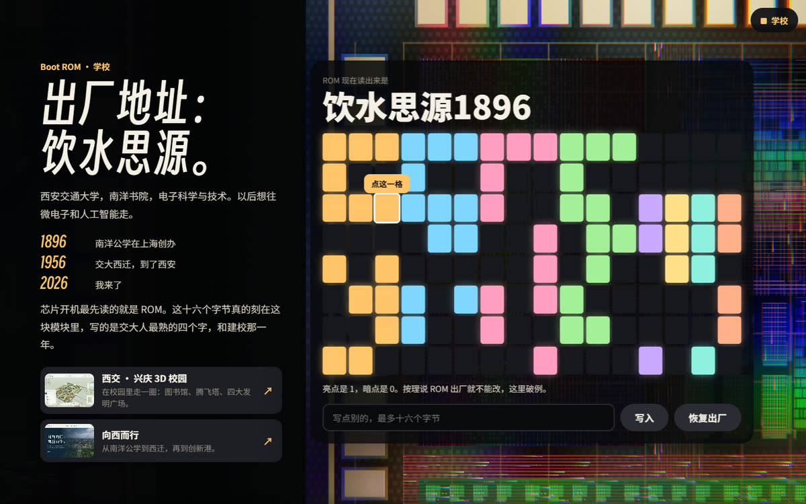
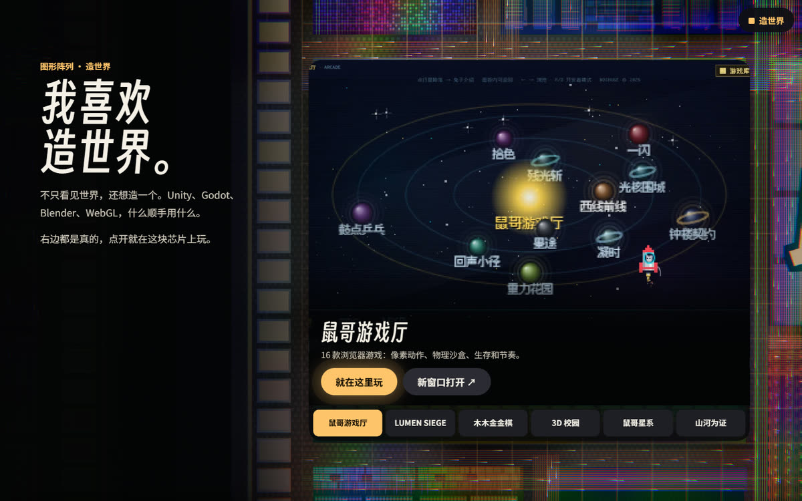
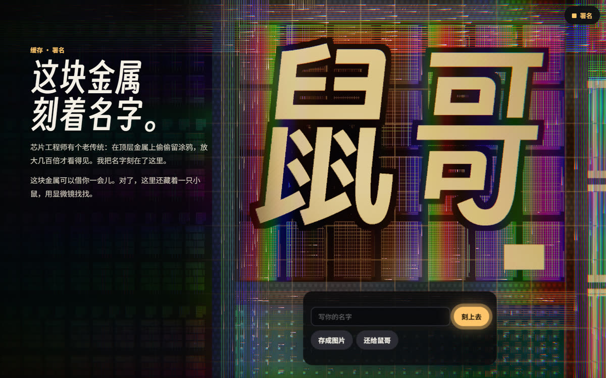
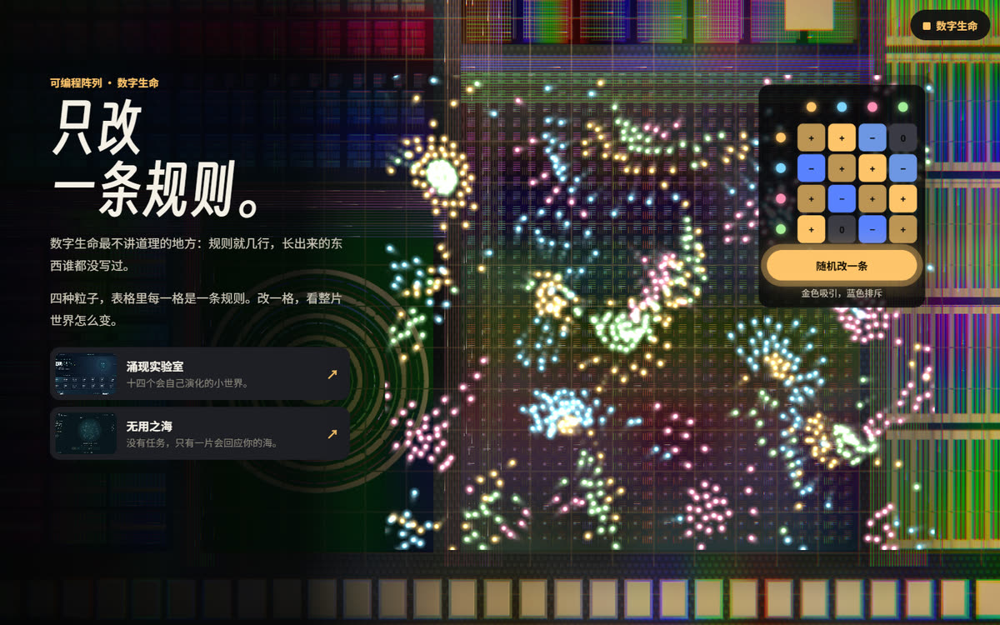
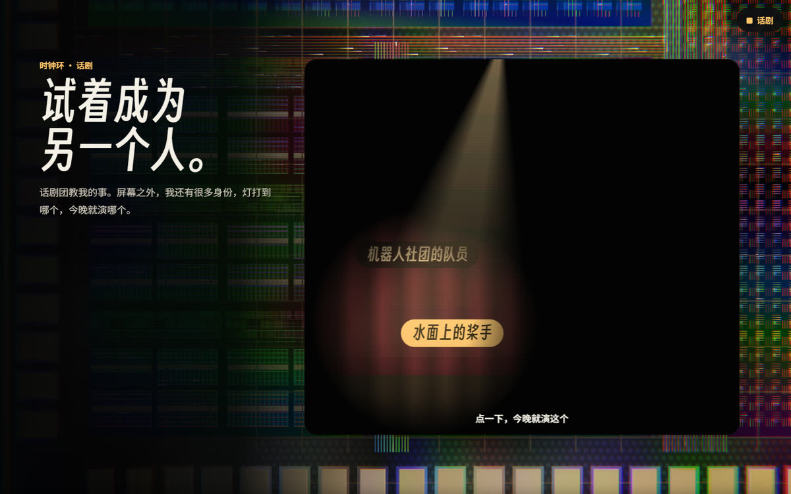
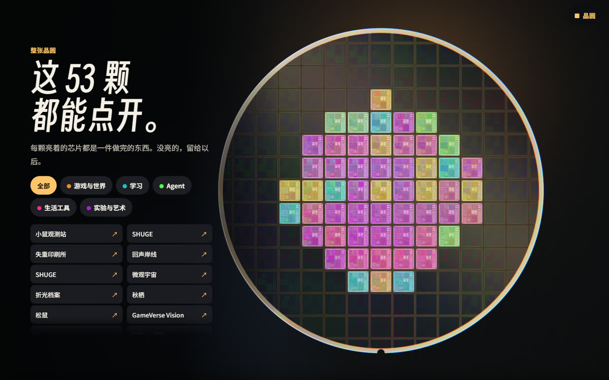
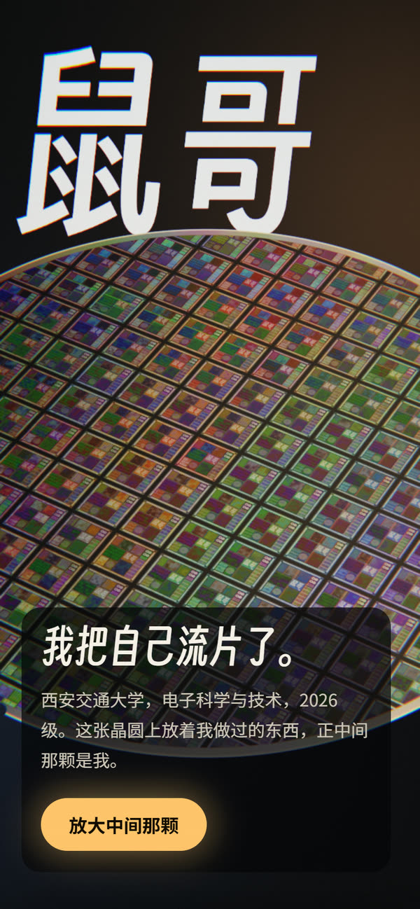
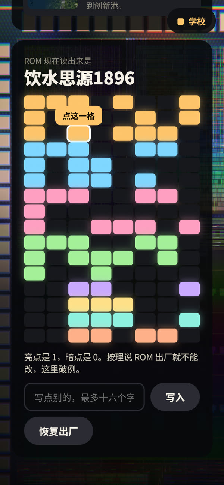
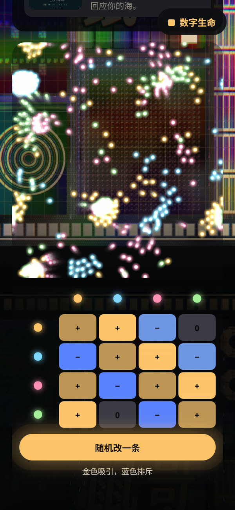

<div align="center">

<a href="https://ndshuge.github.io/shuge-tapeout/"></a>

# 我把自己流片了

**鼠哥的个人主页。一张可以一路放大的硅晶圆，正中间那颗芯片是我。**

<a href="https://ndshuge.github.io/shuge-tapeout/"></a>


</div>

<br>

晶圆上每颗点亮的芯片，都是一件做完的作品。正中间那颗是我：放大进去，学校、Agent、乐队、机器人、话剧、赛艇，都是它上面的功能模块。

滚动就是调焦。鼠标移到芯片上，显微镜会掀开顶层金属，下面是另一层电路。

## 芯片规格书

十个模块，十件我在意的事，每一块都能上手。

| 模块 | 对应的我 | 上手试试 |
| :-- | :-- | :-- |
| **Boot ROM** | 西安交通大学，电子科学与技术 | 点比特改写 ROM，把十六个字节换成你想说的话 |
| **Agent 核心** | [Mice Hole](https://github.com/ndshuge/micehole) 和我做的智能体 | 看一遍 Mice Hole 怎么替 ChatGPT 动手 |
| **协处理器** | 学习工具 | 先预测 MOS 管会怎样，再做实验验证 |
| **模拟电路** | 乐队 | 四轨鼓机，芯片的电流跟着底鼓走 |
| **图形阵列** | 造世界 | 不用跳转，游戏和 3D 校园就在芯片上开 |
| **缓存** | 署名 | 把你的名字刻上金属，存成图片带走 |
| **可编程阵列** | 数字生命 | 改一条粒子规则，看整片世界怎么变 |
| **执行器** | 机器人社团，RoboCup | 同一段代码，切到“真实世界”再跑一次 |
| **时钟环** | 话剧团 | 灯打到哪个身份，今晚就演哪个 |
| **电源管理** | 赛艇 | 芯片快没电了，跟着节奏拉桨把它充满 |

芯片工程师有在顶层金属上偷偷留涂鸦的老传统。这块芯片上也藏了一只小鼠，普通视角看不见。

## 放大看看

<table>
  <tr>
    <td width="50%"></td>
    <td width="50%"></td>
  </tr>
  <tr>
    <td align="center"><sub><b>Boot ROM</b>　这十六个字节真的刻在版图上</sub></td>
    <td align="center"><sub><b>图形阵列</b>　右边都是真的，点开就玩</sub></td>
  </tr>
  <tr>
    <td></td>
    <td></td>
  </tr>
  <tr>
    <td align="center"><sub><b>缓存</b>　这块金属可以借你一会儿</sub></td>
    <td align="center"><sub><b>可编程阵列</b>　规则就几行，长出来的没人写过</sub></td>
  </tr>
  <tr>
    <td></td>
    <td></td>
  </tr>
  <tr>
    <td align="center"><sub><b>时钟环</b>　试着成为另一个人</sub></td>
    <td align="center"><sub><b>整张晶圆</b>　这 53 颗都能点开</sub></td>
  </tr>
</table>

手机上也是完整的，面板会从硅片上落回页面里。

<table>
  <tr>
    <td width="33%"></td>
    <td width="33%"></td>
    <td width="33%"></td>
  </tr>
</table>

## 这块芯片是怎么造的

没有框架，没有打包，浏览器直接跑原生 ES modules 和 WebGL2。

- **版图是算出来的。** 贴图由种子程序生成，桌面 4096²，触屏 2048²，一路放大都不用照片。
- **彩虹反光是物理模型。** 晶圆的衍射按 *GPU Gems* 第 8 章的思路做成 LUT，再叠薄膜干涉和 bloom。
- **显微镜是真的多一层。** 掀开顶层金属露出器件层，小鼠只画在下面这一层。
- **镜头听滚动条的。** 用的是浏览器原生滚动，每一节一个 `data-shot` 镜头，键盘和“减弱动态”都能用。
- **玩具懒加载。** 每个模块实现 `mount(el, app)` → `{frame, wake, sleep, resize}`，飞到才启动。
- **低配有退路。** 动态分辨率兜底；没有 WebGL2 时退回普通长页，文字、面板和作品列表都在。

<details>
<summary><b>本地运行和目录</b></summary>

<br>

```bash
node tools/serve.mjs . 18973
```

打开 <http://127.0.0.1:18973/>。

| 路径 | 内容 |
| :-- | :-- |
| `index.html` | 全部正文，14 节 |
| `js/gl.js` | WebGL2 渲染：衍射、薄膜干涉、显微镜、bloom |
| `js/die-gen.js` | 版图贴图生成，署名和小鼠也刻在这里 |
| `js/camera.js` | 每一幕的镜头和滚动跟随 |
| `js/main.js` | 启动、导航、面板钉在硅片上、降级 |
| `js/wafer.js` | 整张晶圆的作品地图和列表 |
| `js/toys/` | 各模块的玩具 |
| `data/works.js` | 作品数据，由 `tools/build-works.py` 生成 |
| `tools/qa/` | Playwright 行为测试 |

标题字体是按站内用字裁出来的子集。改了文案要重跑一次，否则新字会掉回系统字体：

```bash
python tools/subset-font.py
```

</details>

**测试情况**：行为测试只在 Edge（Chromium）上跑过，手机结果来自仿真。Safari、Firefox 和真机还没测，遇到问题欢迎开 Issue。

## 致谢

- 标题字体基于[得意黑 Smiley Sans](https://github.com/atelier-anchor/smiley-sans)（© atelierAnchor，SIL OFL 1.1）。站内使用裁剪后的子集，按 OFL 的保留名称条款改名为 TapeoutDisplay，许可证见 [`fonts/OFL.txt`](fonts/OFL.txt)。
- 晶圆的衍射反光参考了 *GPU Gems* 第 8 章（Simulating Diffraction）。

<div align="center">
<br>
<sub>把想法变成能打开、能操作、能探索的东西。</sub>
</div>
